# End-to-End Windows Brute-Force & Privilege Escalation Detection Using Splunk SPL

## Overview

This project demonstrates an end-to-end Windows security monitoring and detection lab using Splunk Enterprise. It focuses on detecting network-based brute-force login attempts, identifying successful logins following failed attempts, monitoring new account creation, and detecting changes to local Administrators group membership.

The lab uses a Windows 11 virtual machine as the target system and a host machine to simulate network authentication attempts. Windows Security Event Logs are collected using Splunk Universal Forwarder and analyzed in Splunk Enterprise using SPL.

## Objectives

- Simulate network-based Windows authentication failures and successful logins.
- Detect repeated failed login attempts from a source IP address.
- Identify successful authentication following previous failed attempts.
- Monitor the creation of new Windows user accounts.
- Detect users added to the local Administrators group.
- Create and validate Splunk alerts for the detected activities.

## Lab Environment

| Component | Configuration |
|---|---|
| SIEM | Splunk Enterprise |
| Log Collector | Splunk Universal Forwarder |
| Target Machine | Windows 11 Virtual Machine |
| Virtualization | Oracle VirtualBox |
| Network Mode | Host-only |
| Host Machine IP | Host-only host IP |
| Target VM IP | Host-only VM IP |
| Log Source | Windows Security Event Logs |
| Data Source | XmlWinEventLog:Security |

## Project Implementation

### 1. Network Connectivity

Configured host-only networking between the host machine and Windows 11 virtual machine. Verified SMB connectivity over TCP port 445 to perform controlled network authentication tests.

### 2. Brute-Force Simulation

Performed controlled SMB authentication attempts from the host machine against the Windows target VM using a test account.

Generated and investigated:

- Event ID 4625 – Failed Logon
- Event ID 4624 – Successful Logon

Verified the source IP address, target username, and Logon Type 3, confirming that the authentication attempts originated from the network.

### 3. Failed Login Detection

Created an SPL search to identify repeated failed authentication attempts from the same source IP address against the test account within a rolling 10-minute window.

The detection identifies five or more failed attempts and displays the username, source IP address, and failure count.

### 4. Failed Login Followed by Successful Login

Generated controlled failed authentication attempts followed by a successful login from the same source.

Used Splunk SPL with `streamstats` to correlate failed and successful authentication events within a 10-minute window.

### 5. New Account Creation Detection

Created a test Windows account and monitored Event ID 4720 to identify account creation activity.

Verified the target username and the account responsible for the creation event.

### 6. Local Administrators Group Change Detection

Added the test account to the local Administrators group to simulate a controlled privilege change.

Monitored Event ID 4732 and verified the group membership change using the member SID and target group information.

This demonstrates privilege elevation through local group membership modification, not exploitation of a vulnerability.

## Windows Security Event IDs

| Event ID | Description | Purpose |
|---|---|---|
| 4624 | Successful Logon | Identify successful authentication |
| 4625 | Failed Logon | Detect failed authentication attempts |
| 4720 | User Account Created | Monitor new account creation |
| 4732 | Member Added to Security-Enabled Local Group | Detect local group membership changes |

## Splunk Detection and Alert Validation

Created and validated the following Splunk alerts:

| Alert Name | Detection Purpose |
|---|---|
| Windows Brute-Force Detection | Detect repeated failed login attempts |
| Failed Login Followed by Successful Login | Correlate failed attempts followed by a successful login |
| Windows New Account Creation Detection | Detect newly created Windows accounts |
| Windows - Local Administrators Group Change | Detect additions to the local Administrators group |

The alerts were configured as scheduled searches and their triggering activity was verified in Splunk Triggered Alerts.

## MITRE ATT&CK Mapping

| Technique ID | Technique | Project Activity |
|---|---|---|
| T1110 | Brute Force | Repeated failed authentication attempts |
| T1136 | Create Account | Creation of a new local Windows account |
| T1098 | Account Manipulation | Addition of a user to the local Administrators group |

## Evidence and Screenshots

### Lab Connectivity and Windows Events

1. **Network Connectivity**  
   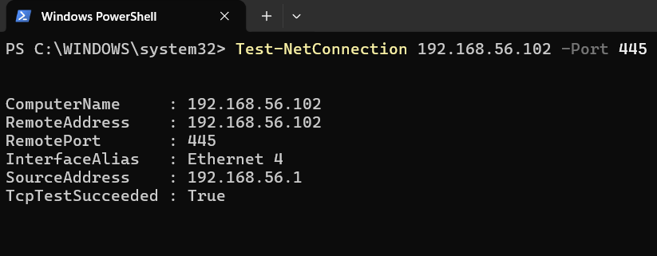

2. **Windows Logon Events – 4625 and 4624**  
   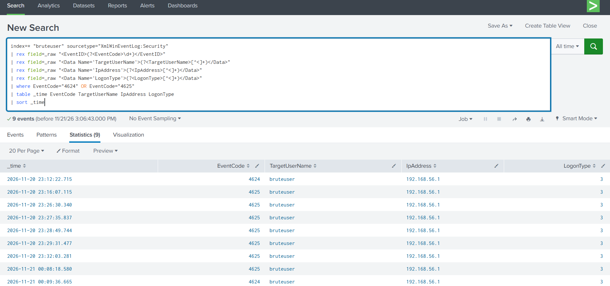

3. **Account Creation – Event ID 4720**  
   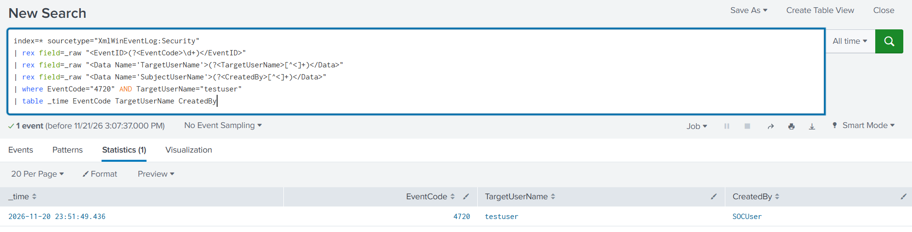

4. **Administrators Group Change – Event ID 4732**  
   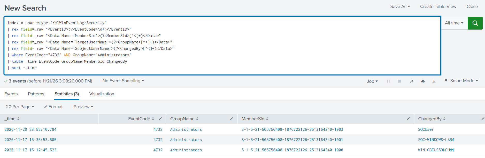

### Splunk Detection Results

5. **Brute-Force Detection**  
   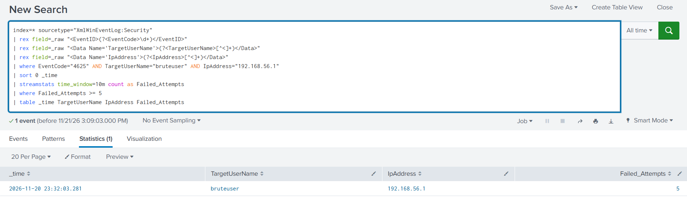

6. **Failed Login and Successful Login Correlation**  
   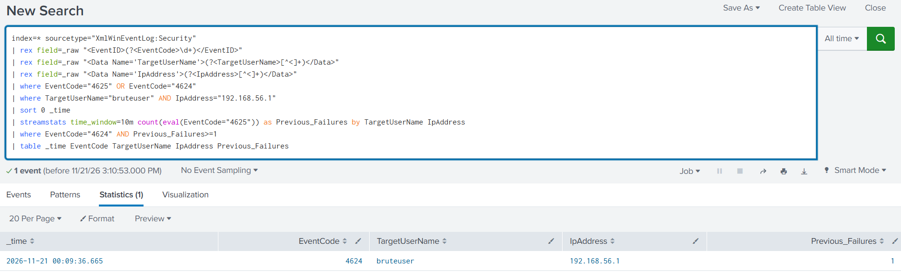

7. **Account Creation Detection**  
   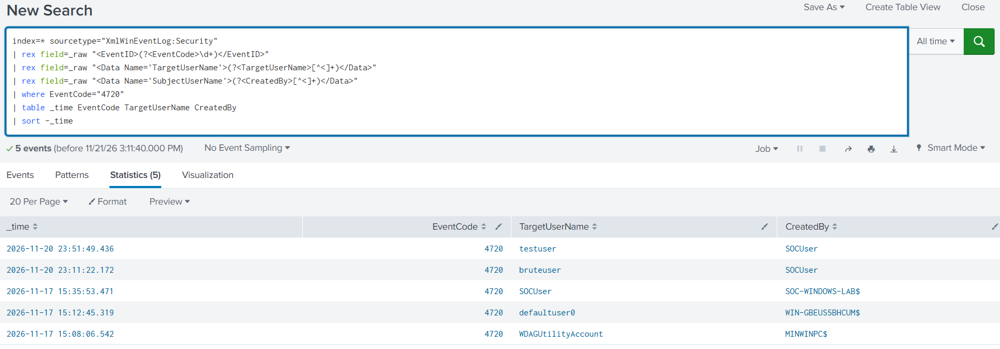

8. **Administrators Group Change Detection**  
   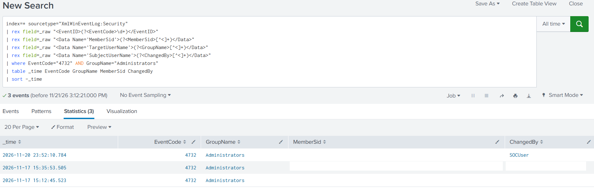

### Splunk Alert Validation

9. **Brute-Force Alert Triggered**  
   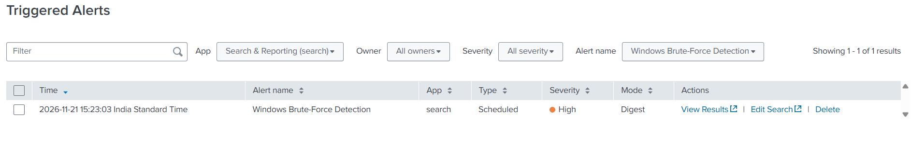

10. **Login Correlation Alert Triggered**  
    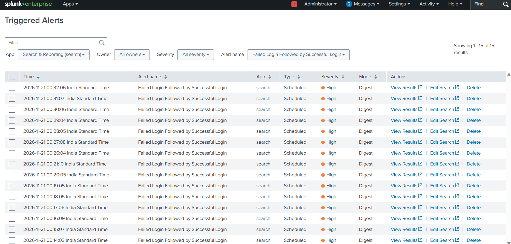

11. **Account Creation Alert Triggered**  
    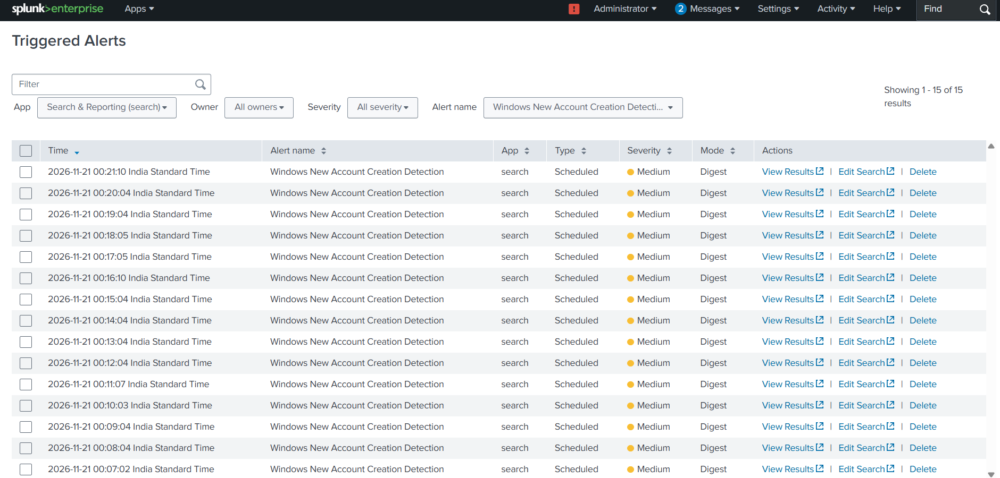

12. **Administrators Group Change Alert Triggered**  
    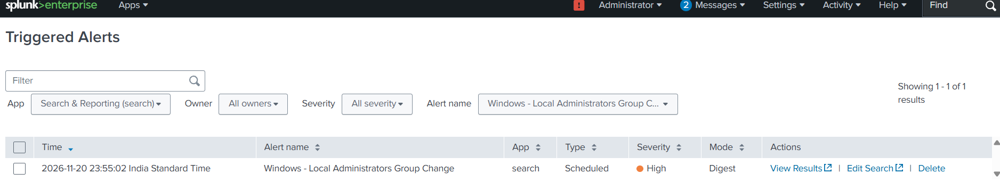

## Key Learnings

- Windows Security Event Log analysis.
- Splunk Universal Forwarder log collection and forwarding.
- Splunk Search Processing Language (SPL).
- Windows authentication monitoring.
- Brute-force detection and event correlation.
- Account creation and local group membership monitoring.
- Scheduled alert configuration and validation.
- Mapping security events to MITRE ATT&CK techniques.

## Limitations

- The project was conducted in an isolated virtual lab environment using controlled authentication attempts and account changes.
- The privilege escalation scenario demonstrates controlled local Administrators group membership modification, not exploitation of a vulnerability.
- The correlation and account-creation alerts fired repeatedly for the same underlying events because scheduled searches re-evaluated the same results on each run. A production deployment would use alert throttling, suppression, or deduplication to reduce duplicate notifications and alert fatigue.

## Tools and Technologies

- Splunk Enterprise
- Splunk Universal Forwarder
- Windows 11
- Oracle VirtualBox
- Windows Security Event Logs
- PowerShell
- Command Prompt
- Splunk SPL

## Author

**Gayathri C.**

GitHub: https://github.com/c-gayathri-cyber
